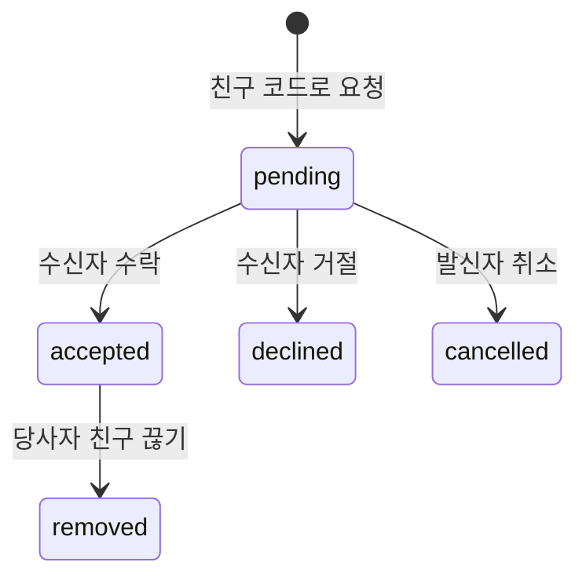

# 친구와 실시간 알림

## DB 변경과 검증

설치·변경·원격 확인은 [DB 관리 절차](database-management.md)를 따릅니다. 과거 번호 SQL을 다시 실행하지 않습니다. 앱 타입은 일부 계약만 표현하므로 전체 스키마나 현재 원격 상태로 해석하지 않습니다.

## 자유게시판

소셜 메뉴는 게시판과 건의·버그 제보로 직접 연결합니다. 알림·선물 화면은 알림 버튼에서 계속 접근하며, 예전 광장 주소는 자유게시판으로 이동합니다.

게시글·댓글의 작성자는 서버에서 인증 계정으로 결정합니다. 클라이언트의 테이블 직접 쓰기는 막고, 글·댓글·반응 변경은 인증을 확인하는 RPC로 처리합니다. 일반 이용자는 본인 글과 댓글만 수정·삭제할 수 있으며 운영자는 삭제할 수 있습니다. 댓글을 지워도 답글 맥락을 보존하기 위해 내용만 비웁니다. 게시글 삭제는 댓글·반응·관련 알림도 함께 지웁니다.

새 댓글은 게시글에만 작성합니다. 화면의 답글 버튼을 제거하고 DB 삽입 트리거에서도 부모 댓글이 지정된 새 답글을 거절해 이전 클라이언트의 요청도 차단합니다. 기존 답글은 삭제하지 않으며 조회·수정·삭제·반응은 유지합니다. 글과 댓글에는 본인도 반응할 수 있으며, 좋아요·싫어요 중 한 상태만 유지합니다. 반응 API에는 토글 명령 대신 원하는 상태를 보내고, 댓글 생성에는 요청 ID를 재사용해 네트워크 재시도로 반응이나 알림이 중복되지 않게 합니다. 댓글과 알림은 같은 트랜잭션으로 저장합니다. 본인과 반응에는 알림을 보내지 않습니다.

사진은 비공개 Storage에 저장하고 서명 URL로 표시합니다. 업로드는 본인 경로만 허용하고, 글이 참조 중인 사진은 지울 수 없습니다. 편집 저장 후 제거한 첨부와 명시적으로 취소한 초안은 정리합니다. 브라우저 강제 종료로 남은 미참조 파일은 추후 정리가 필요하며, 참조 여부를 확인하지 않은 일괄 삭제는 하지 않습니다.

배포 전 `board-sql` 테스트로 권한·반응·알림·사진 접근을, `board-ui` 테스트로 작성·답글 재시도·삭제 확인을 검사합니다. 이후 DB context와 verify를 실행합니다. 배너 생성 근거는 이미지 manifest에 둡니다.

## 프로필과 친구 관계

친구는 중복 가능한 닉네임 대신 고유한 친구 코드로 찾거나, 등대의 전체 유저 탭에서 요청합니다. 프로필 테이블의 직접 조회는 본인 또는 요청 관계가 있는 프로필로 제한합니다. 전체 유저 탭은 로그인한 회원에게 공개 표시 정보만 페이지 단위로 제공하는 별도 API를 사용합니다. 이메일·친구 코드·접속 상태·경험치 원본은 목록에 포함하지 않습니다.

목록의 친구 추가는 서버에서 대상 ID를 기존 코드 기반 요청 처리로 연결합니다. 기존 중복 방지·전송 제한·알림 트랜잭션을 우회하지 않습니다. 친구·보낸 요청·받은 요청은 이 목록에서 표시만 하며, 수락이나 친구 방문 등 다른 동작은 원래 화면에서 수행합니다. 권한과 반환 필드 범위는 `player-directory-sql`, 탭과 목록 동작은 `player-directory` 및 `friends-page` 테스트로 검증합니다.

Auth의 game_nickname은 프로필 표시용으로만 동기화합니다. RPC는 auth.uid()로 본인을 결정합니다. nickname 설정을 마치고 앱을 열면 sync_player_profile이 친구 코드를 생성합니다. 닉네임이 바뀌어도 친구 코드는 유지됩니다.

요청 상태:



accepted 행이 친구 관계입니다. 거절/취소 이력은 재활성화하지 않고, 새 요청은 새 ID를 만듭니다. 예전 알림이 새 요청의 수락 버튼으로 바뀌지 않게 하기 위한 구조입니다. 친구 끊기는 accepted → removed로 처리합니다. 양 당사자만 실행할 수 있고 행 잠금으로 중복 처리를 막습니다. 이력은 유지하고 관련 알림은 읽음 처리하며 별도 해제 알림은 보내지 않습니다. 차단은 구현하지 않았습니다.

- 자기 자신, 중복/역방향 pending, 이미 accepted인 관계는 차단.
- 서버에서 발신자별 1분 5건, 미처리 발신 요청 30건, 같은 쌍의 재요청 1분 대기.
- 발신자/쌍 기준 트랜잭션 잠금과 활성 쌍 UNIQUE 인덱스로 경쟁 요청을 제어.
- 응답은 행 잠금으로 한 번만 처리. 거절 결과는 별도 알림으로 보내지 않음.

## 두 알림 종류

| category | kind | 생성 주체 | 수신자 |
| --- | --- | --- | --- |
| friend | friend_request | 친구 요청 RPC | 요청받은 사용자 |
| friend | friend_accepted | 수락 RPC | 요청한 사용자 |
| general | announcement / reward / system | DB 관리자 또는 신뢰된 서버 | 지정한 사용자 |

우편함은 공지/친구/소식/선물 탭과 분류별 안 읽은 개수를 제공합니다. 수동 읽음·모두 읽음 버튼은 없습니다. 알림 드롭다운을 열면 `notifications_opened`가 호출되어 해당 사용자에게 그 시점까지 도착한 전체 알림을 서버 시각으로 확인 처리합니다. 드롭다운을 닫은 뒤 도착한 새 알림은 다음 확인까지 유지합니다. 또한 공지 원문·선물 상세를 정상 조회하거나 선물을 수령하고 친구 요청을 처리하면 관련 알림을 자동 확인합니다. 확인 실패는 안내하고 다시 열어 재시도할 수 있습니다. 공지는 첫 게시 시 서버가 전송하며 [공지 시스템](notices.md)을 따릅니다. 선물 탭에는 받은/보낸 선물함만 표시합니다. 알림은 최신 100건을 표시하지만 안 읽은 개수와 드롭다운 확인 처리는 전체 이력을 대상으로 합니다. 친구·요청 화면은 최신 활성 관계 500건을 표시합니다.

notifications.read_at과 friend_requests.status는 독립적입니다. 읽음 표시는 요청을 수락/거절하지 않습니다. 요청 처리 시 서버가 기존 friend_request 알림을 읽음으로 바꿉니다. 친구 알림의 문구는 당시 닉네임이며 현재 친구 목록에는 재조회 시 최신 닉네임을 표시합니다.

일반 알림을 테스트하려면 `supabase/sql/examples/send-general-notification.sql`의 UUID를 받는 사용자의 player_profiles.id로 바꿔 실행합니다. 일반 사용자에게 INSERT 권한을 주지 않습니다. 향후 운영 이벤트/보상 처리 서버에서 service-role 자격 증명으로 알림을 작성합니다. 브라우저의 VITE_*에는 service-role/secret 키를 넣지 않습니다. 알림은 보상 지급 권한이나 지급 내역 자체가 아닙니다.

## Realtime 구현

`src/features/social/social-provider.tsx`가 로그인 계정당 채널 하나를 유지합니다.

- notifications INSERT/UPDATE: recipient_id 필터.
- friend_requests INSERT/UPDATE: sender_id와 recipient_id 필터.
- RLS가 실제 데이터 접근을 제한하며 클라이언트 필터만 보안에 의존하지 않음.
- 프로필 동기화 후 구독을 열고 초기 데이터 조회. SUBSCRIBED 때 재조회해 구독 사이 빈틈 보완.
- 신규 INSERT만 Sonner 토스트, 같은 ID 중복 토스트 방지. 기존 저장 알림을 불러올 때 토스트를 재생하지 않음.
- 변경 이벤트는 120ms 동안 모아서 조회하며 늦게 끝난 이전 조회는 최신 데이터를 덮지 못함.
- 다시 연결되거나 앱에 포커스/온라인/가시성 복귀 시 저장 상태 재조회.
- 로그아웃/계정 변경 때 채널·타이머·이벤트 리스너 제거. 이전 계정 데이터는 즉시 가림.
- 계정 삭제처럼 현재 기능 외부의 DELETE는 다음 재조회에서 반영. 앱을 닫았을 때의 OS 푸시는 별도 구현 대상.

## 권한 설계

- 요청은 양 당사자만 SELECT. 브라우저 INSERT/UPDATE/DELETE 없음.
- 알림은 수신자만 SELECT와 UPDATE(read_at). 제목/내용/수신자/종류/요청 참조 변경 불가.
- 친구 요청/상태 변경은 public INVOKER 래퍼 → app_private의 인증/당사자 검사를 거치는 DEFINER 함수.
- DEFINER는 search_path를 비우고 완전한 스키마명을 사용. anon/PUBLIC 실행 권한은 제거.
- 일반 알림은 관리자/서버만 작성. 미로그인 사용자는 세 테이블/RPC에 접근할 수 없음.

## 검증

자동:

```bash
npm test
npm run build
```

SQL 테스트는 PGlite의 실제 PostgreSQL 엔진에서 auth.users/역할/auth.uid()를 최소 모사한 뒤 설치 SQL을 그대로 실행합니다. 다른 사용자 조회·위조 차단, 수락/거절/취소, 중복 방지, rate limit, Publication을 검증합니다. Supabase Realtime 서비스 전달 자체는 모의 테스트로 대체할 수 없습니다.

원격 적용 후:

1. 서로 다른 브라우저/시크릿 창에서 A/B 계정으로 로그인하고 닉네임 설정.
2. 친구 화면에서 각자 친구 코드 확인. A가 B 코드로 요청.
3. B의 친구 토스트, 친구 탭, 안 읽은 배지와 받은 요청 확인.
4. 알림만 읽음 처리했을 때 요청이 pending으로 남는지 확인.
5. B가 수락하면 A에 수락 알림, 양쪽 친구 목록 갱신 확인.
6. 다른 두 계정으로 거절/취소 확인. 거절 알림은 발신자에게 없음.
7. 관리자 SQL로 A에게 일반 알림을 넣어 소식 탭/토스트/배지 확인. B에게는 보이지 않아야 함.
8. 탭을 닫았다가 다시 열어 저장 이력 확인. 오프라인/재접속, 로그아웃/계정 변경도 확인.

오류 시 먼저 SQL 전체 적용, Publication, 로그인 사용자, 프로필 동기화와 RLS를 확인합니다. 앱은 SQL 미적용/네트워크 실패 시 재시도 가능한 오류를 표시하며 로그인 자체는 유지합니다.

공식 자료:
- https://supabase.com/docs/guides/realtime/postgres-changes
- https://supabase.com/docs/guides/database/postgres/row-level-security
- https://supabase.com/docs/guides/database/functions

## 만남의 등대

친구 목록의 접속 표시는 앱을 보고 있는지 구분하기 위한 대략적인 상태입니다. 인증 계정이 탭별로 상태를 갱신하고, 친구 목록을 보는 동안만 묶음 조회합니다. 백그라운드에서는 자리 비움을 한 번 전송하고 주기 갱신을 멈춥니다. 종료 전송은 브라우저가 보장하지 않으므로 서버의 최근 갱신 유효기간이 지나면 미접속으로 판단합니다. 다른 탭이 활성 상태이면 접속 중을 우선하며, 요청 순번으로 늦게 도착한 이전 상태가 최신 상태를 덮지 못하게 합니다.

조회는 서버가 현재 수락된 친구 관계로 제한합니다. 접속 세션 원본과 마지막 접속 시각은 클라이언트에 공개하지 않습니다. 네트워크 오류나 조회 대기는 미접속과 구분하고, 목록은 상태 변경으로 자동 재정렬하지 않습니다. 계정 전환·친구 변경 때 이전 조회를 폐기하며, 접속 표시에 실패해도 낚시나 친구 방문은 계속 사용할 수 있어야 합니다. 오래된 본인 세션은 다음 갱신 때 정리하며, 접속 이력이나 푸시 알림으로 사용하지 않습니다.

`friend-presence-sql`은 친구 범위·권한·다중 탭·유효기간·순번을, `friend-presence`와 `friends-page`는 생명주기·계정 전환·오류와 필터를 검증합니다. 운영 검증은 서로 친구인 두 계정으로 전경·백그라운드·복귀·강제 종료를 확인하며, 모의 브라우저 검증을 실제 기기 전달 성공으로 해석하지 않습니다.

경로는 /friends입니다. 친구·요청·친구 찾기 탭을 제공합니다. 친구 끊기는 remove-friend-button.tsx의 shadcn AlertDialog 확인 후 public.remove_friend RPC를 호출합니다. 구현 SQL은 07-friend-removal/01-remove-friend.sql입니다. 기존 friend_requests UPDATE 구독으로 양쪽 목록을 재조회합니다. 재요청에는 기존 1분 대기 규칙을 적용합니다. SQL 테스트는 양 당사자의 해제, 제삼자·미인증 차단, 중복 처리 및 재요청을 검증합니다.
